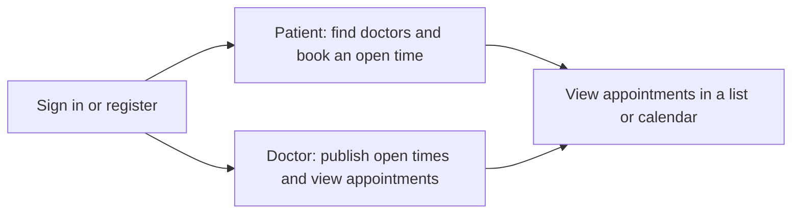

# HAMS

HAMS is a simple hospital appointment app for patients and doctors.




## How it works

- Sign in and register with Firebase Authentication. New accounts must verify their email.
- Doctor accounts publish available appointment times.
- Patients choose an open time to book with a doctor.
- Both patients and doctors can view appointments as a list or calendar.
- Firebase Cloud Firestore stores profiles, schedules, and appointments.

## Firebase setup

The app is configured for the Firebase project `hams-reboot` with the Android package `com.aroha.hams`.

1. In Firebase Console, enable **Email/Password** under Authentication.
2. Create the default Cloud Firestore database.
3. Publish the rules in [`firestore.rules`](firestore.rules) from **Firestore Database → Rules**.
4. Make sure email verification is enabled for the Firebase project.

## Build

Open this project in Android Studio and run the `app` configuration, or build from the repository root:

```powershell
.\gradlew.bat :app:assembleDebug
```
